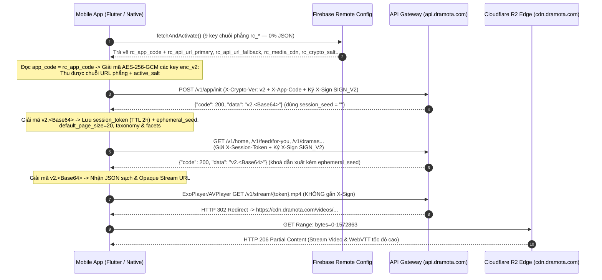
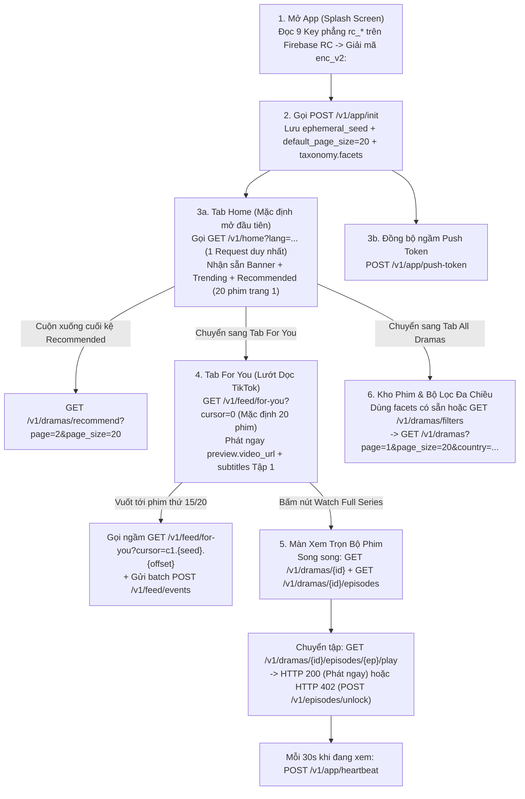

# 📱 TÀI LIỆU ĐẶC TẢ TÍCH HỢP MOBILE API TOÀN DIỆN (V4.4 PRODUCTION)

> **Hệ thống:** Multi-App Short Drama Platform (`https://api.dramota.com` & Edge CDN `https://cdn.dramota.com`)  
> **Cổng Tài Liệu Trực Tuyến & Live Decrypt Sandbox:** Truy cập `/api-docs` trên máy chủ (yêu cầu mật khẩu bảo vệ cấu hình tại tab **Bảo Mật & Anti-Scrape** trên CMS).  
> **Đối tượng áp dụng:** Đội ngũ phát triển Mobile App (Flutter, Android Native Kotlin, iOS Swift) & QA Automation.  
> **Quy chuẩn phân trang mặc định toàn hệ thống:** **Mặc định `20` phim / lần gọi** trên tất cả API danh sách & luồng vuốt; nếu App truyền tường minh `count` hoặc `page_size` (`1..60`), Server trả về đúng số lượng App yêu cầu.

---

## 📑 MỤC LỤC

1. [Tổng Quan Kiến Trúc Kết Nối & Phân Tầng Chịu Tải](#1-tổng-quan-kiến-trúc-kết-nối--phân-tầng-chịu-tải)
2. [Đặc Tả Bảo Mật & Mã Hoá 7 Lớp (Byte-Level Specification)](#2-đặc-tả-bảo-mật--mã-hoá-7-lớp-byte-level-specification)
   - [2.1. Sơ Đồ Bắt Tay Bảo Mật Tổng Thể](#21-sơ-đồ-bắt-tay-bảo-mật-tổng-thể)
   - [2.2. Lớp 1 & 2: Giải Mã Cấu Hình Khởi Động Firebase Remote Config (`RC_V2`)](#22-lớp-1--2-giải-mã-cấu-hình-khởi-động-firebase-remote-config-rc_v2)
   - [2.3. Lớp 3: Bộ Header Định Danh Bắt Buộc & Chữ Ký Request Động (`SIGN_V2`)](#23-lớp-3-bộ-header-định-danh-bắt-buộc--chữ-ký-request-động-sign_v2)
   - [2.4. Lớp 4: Giải Mã Envelope Phản Hồi Động (`RESP_V2` — AES-256-GCM)](#24-lớp-4-giải-mã-envelope-phản-hồi-động-resp_v2--aes-256-gcm)
   - [2.5. Lớp 5 & 6: Opaque Stream Token Khoá IP Subnet & Edge CDN Redirect (`HTTP 302 -> 206`)](#25-lớp-5--6-opaque-stream-token-khoá-ip-subnet--edge-cdn-redirect-http-302---206)
   - [2.6. Bảng Mã Phản Hồi HTTP & Cấu Trúc Lỗi / Paywall `HTTP 402`](#26-bảng-mã-phản-hồi-http--cấu-trúc-lỗi--paywall-http-402)
   - [2.7. Vector Kiểm Thử Chuẩn (Unit Test Verification Vector)](#27-vector-kiểm-thử-chuẩn-unit-test-verification-vector)
3. [Thứ Tự Gọi API Bắt Buộc, Cơ Chế Cache & Phối Hợp Preload Dưới App](#3-thứ-tự-gọi-api-bắt-buộc-cơ-chế-cache--phối-hợp-preload-dưới-app)
   - [Giai Đoạn 1: Khởi Động App (Cold Start / Splash Screen)](#giai-đoạn-1-khởi-động-app-cold-start--splash-screen)
   - [Giai Đoạn 2: Màn Hình Trang Chủ (Home Tab) & Kệ "Recommended for You" (20 Phim/Trang)](#giai-đoạn-2-màn-hình-trang-chủ-home-tab--kệ-recommended-for-you-20-phimtrang)
   - [Giai Đoạn 3: Tab Lướt Dọc "For You" — Shared Interest-Cohort & Preload Chuẩn TikTok](#giai-đoạn-3-tab-lướt-dọc-for-you--shared-interest-cohort--preload-chuẩn-tiktok)
   - [Giai Đoạn 4: Tab "All Dramas" — Bộ Lọc Quốc Gia & Đa Chiều Tốc Độ Cao](#giai-đoạn-4-tab-all-dramas--bộ-lọc-quốc-gia--đa-chiều-tốc-độ-cao)
   - [Giai Đoạn 5: Xem Trọn Bộ ("Watch Full Series"), Mở Khoá Tập (`HTTP 402`) & Heartbeat](#giai-đoạn-5-xem-trọn-bộ-watch-full-series-mở-khoá-tập-http-402--heartbeat)
   - [Giai Đoạn 6: My List, Lịch Sử Xem, Trung Tâm Thưởng Xu & Nạp IAP](#giai-đoạn-6-my-list-lịch-sử-xem-trung-tâm-thưởng-xu--nạp-iap)
4. [Chuẩn Hoá Đối Tượng Dữ Liệu Dùng Chung (`DramaCard` & Quốc Gia Sản Xuất)](#4-chuẩn-hoá-đối-tượng-dữ-liệu-dùng-chung-dramacard--quốc-gia-sản-xuất)
5. [Đặc Tả Chi Tiết Toàn Bộ 30 API Theo 7 Cụm Tính Năng (`Nhóm A` → `Nhóm G`)](#5-đặc-tả-chi-tiết-toàn-bộ-30-api-theo-7-cụm-tính-năng-nhóm-a--nhóm-g)
   - [🚀 Nhóm A: Khởi Động Phiên, Đồng Bộ Push Token & Nhịp Tim Xem Phim (3 API)](#-nhóm-a-khởi-động-phiên-đồng-bộ-push-token--nhịp-tim-xem-phim-3-api)
   - [🏠 Nhóm B: Trang Chủ, Đề Xuất (`Recommended`), Bộ Lọc Quốc Gia & Tìm Kiếm (10 API)](#-nhóm-b-trang-chủ-đề-xuất-recommended-bộ-lọc-quốc-gia--tìm-kiếm-10-api)
   - [🔥 Nhóm C: Tab Lướt Video Dọc "For You" — Shared Interest-Cohort Engine (2 API)](#-nhóm-c-tab-lướt-video-dọc-for-you--shared-interest-cohort-engine-2-api)
   - [🎬 Nhóm D: Chi Tiết Phim, Danh Sách Tập, Phát Video & Mở Khoá Paywall (6 API)](#-nhóm-d-chi-tiết-phim-danh-sách-tập-phát-video--mở-khoá-paywall-6-api)
   - [❤️ Nhóm E: Tủ Phim Yêu Thích (`My List`) & Lịch Sử Xem (`History`) (6 API)](#️-nhóm-e-tủ-phim-yêu-thích-my-list--lịch-sử-xem-history-6-api)
   - [🎁 Nhóm F: Trung Tâm Thưởng Xu — Điểm Danh 7 Ngày & Nhiệm Vụ (3 API)](#-nhóm-f-trung-tâm-thưởng-xu--điểm-danh-7-ngày--nhiệm-vụ-3-api)
   - [💳 Nhóm G: Hồ Sơ Cá Nhân, Gói Nạp IAP / VIP & Tài Khoản (6 API)](#-nhóm-g-hồ-sơ-cá-nhân-gói-nạp-iap--vip--tài-khoản-6-api)

---

## 1. Tổng Quan Kiến Trúc Kết Nối & Phân Tầng Chịu Tải

Hệ thống được thiết kế theo mô hình **Multi-App Isolation** (một Backend phục vụ đồng thời nhiều Mobile App độc lập qua mã định danh `app_code` / `rc_app_code` và `package_name`) kết hợp **3 tầng tăng tốc bộ nhớ đệm** để đảm bảo thời gian phản hồi API đạt **`1ms – 15ms`** ngay cả ở quy mô hàng trăm nghìn người dùng đồng thời:

1. **Tầng Control Plane (`https://api.dramota.com/v1/*`):**
   - Toàn bộ API JSON đi qua cổng HTTPS Reverse Proxy -> cụm Worker FastAPI bất đồng bộ -> L1 In-Memory Cache + L2 Redis 7 Shared Cache -> PostgreSQL 16.
   - Dữ liệu người dùng (Ví Xu, Gói VIP, Tập đã mở khoá, Tủ phim My List, Lịch sử xem, Vector sở thích 5 chiều) gắn liền với định danh thiết bị bền vững `x_device_id` (chế độ **Guest-First**: người dùng vào App xem phim, tích Xu, mua VIP ngay lập tức mà không ép đăng nhập; khi liên kết Google/Apple sau đó, toàn bộ tài sản Guest được giữ nguyên 100%).
2. **Tầng Data Plane — Truyền Phát Media (`https://cdn.dramota.com/*`):**
   - App **tuyệt đối không** truy cập trực tiếp đường dẫn lưu trữ gốc của kho phim.
   - Mọi tập phim được cấp phát dưới dạng **Opaque Stream URL** tạm thời (`https://api.dramota.com/v1/stream/{opaque_token}.mp4` và `.vtt`).
   - Khi ExoPlayer / AVPlayer mở URL này, Backend xác thực chữ ký + IP subnet trong `< 0.5ms` (Zero-SQL qua RAM/Redis) rồi trả **`HTTP 302 Found`** điều hướng sang mạng biên **Cloudflare R2 Global CDN (`https://cdn.dramota.com`)** hỗ trợ tua video tức thì qua **`HTTP 206 Partial Content` (`Range: bytes=...`)**.

---

## 2. Đặc Tả Bảo Mật & Mã Hoá 7 Lớp (Byte-Level Specification)

> [!IMPORTANT]
> - Trong mã nguồn APK / IPA phát hành lên Store **TUYỆT ĐỐI KHÔNG hardcode URL máy chủ API**. URL máy chủ (`rc_api_url_primary`, `rc_api_url_fallback`, `rc_media_cdn`), mã định danh App (`rc_app_code`) và muối xoay khoá (`rc_crypto_salt`) được tải động từ **9 Key chuỗi phẳng chuẩn `snake_case` (`rc_*`) trên Firebase Remote Config** (0% JSON, tuân thủ biểu thức `^[A-Za-z_][A-Za-z0-9_]*$` của Firebase Console, không dấu gạch ngang `-`).
> - Khóa bí mật `app_native_secret` của từng App lấy tại **CMS Admin → Quản Lý Ứng Dụng → Chọn App → Tab 5 (Bảo Mật 7 Lớp)** và phải được cất giữ trong tầng Native C++ JNI (`libdramaguard.so`) / Dart FFI / iOS Keychain Obfuscation.

### 2.1. Sơ Đồ Bắt Tay Bảo Mật Tổng Thể



---

### 2.2. Lớp 1 & 2: Giải Mã 9 Key Chuỗi Phẳng Trên Firebase Remote Config (`rc_*` & `enc_v2:` — Không Dùng JSON)

> [!WARNING]
> **Hai quy tắc bắt buộc trên Firebase Remote Config:**
> 1. **Tên tham số (Parameter Key):** Chỉ gồm chữ cái, chữ số và dấu gạch dưới `_` (`^[A-Za-z_][A-Za-z0-9_]*$`, **tuyệt đối không dùng dấu gạch ngang `-`**).
> 2. **Giá trị tham số (Default Value):** **100% là chuỗi phẳng đơn giản (Scalar String) — TUYỆT ĐỐI KHÔNG lưu dạng JSON `{...}` hay `[...]`**. Các tham số tuỳ chọn (`rc_api_url_fallback`, `rc_ssl_pins`) khi chưa cấu hình thì để chuỗi rỗng `""`; khi có nhiều giá trị thì ngăn cách bằng dấu phẩy `,` và tự động mã hoá `enc_v2:...` trên CMS (**CMS → Quản lý Ứng dụng → Tab 6**).

| STT | Tên Key trên Firebase RC (`snake_case`) | Chế độ lưu trên Firebase | Giá trị chuỗi phẳng mẫu (Sau giải mã) & Ý nghĩa |
| :-: | :--- | :---: | :--- |
| **1** | `rc_app_code` | Plaintext | `default_app` *(Khớp 1-1 với `app_code` của App trên CMS — **App đọc key này đầu tiên trước khi giải mã các key bên dưới!**)* |
| **2** | `rc_api_url_primary` | **`enc_v2:...` (AES-256-GCM)** | `https://api.dramota.com` *(Domain Backend API chính — chuỗi URL phẳng)* |
| **3** | `rc_api_url_fallback` | `""` hoặc **`enc_v2:...`** | `""` *(Để trống khi chưa dùng; nếu có domain dự phòng điền `https://api2.dramota.com,https://api3.dramota.com` -> tự mã hoá `enc_v2:...`)* |
| **4** | `rc_media_cdn` | **`enc_v2:...` (AES-256-GCM)** | `https://cdn.dramota.com` *(Domain CDN phát Video & Phụ đề — chuỗi URL phẳng)* |
| **5** | `rc_crypto_salt` | **`enc_v2:...` (AES-256-GCM)** | `drama_dynamic_salt_2026` *(Chuỗi muối phẳng nạp trực tiếp vào `active_salt` cho `SIGN_V2` & `RESP_V2`)* |
| **6** | `rc_ssl_pins` | `""` hoặc **`enc_v2:...`** | `""` *(Để trống khi tắt SSL Pinning; khi bật điền `sha256/AAAA...,sha256/BBBB...` -> tự mã hoá `enc_v2:...`)* |
| **7** | `rc_review_ver` | Plaintext | `0` *(Số nguyên dạng chuỗi, điền mã build đang gửi Apple/Google xét duyệt khi cần)* |
| **8** | `rc_maintenance_enabled` | Plaintext | `false` *(`"true"` = bật màn hình bảo trì khẩn cấp ngay từ Splash; `"false"` = hoạt động bình thường)* |
| **9** | `rc_maintenance_msg` | Plaintext | `System maintenance in progress.` *(Thông báo hiển thị cho người dùng khi `rc_maintenance_enabled == "true"`)* |

#### Thuật toán giải mã chuẩn `enc_v2:` (Khớp 100% byte-level với Backend `security.py`):
1. **Đọc `app_code` động từ `rc_app_code`:**
   - `app_code = remoteConfig.getString("rc_app_code").trim()` (nếu offline lần đầu chưa tải được Firebase thì fallback về hằng số `default_app_code` đóng gói trong App).
2. **Xác định `cert_part`:**
   - Nếu trên CMS tắt kiểm tra chứng chỉ APK (`enforce_apk_cert = false`): `cert_part = ""` (chuỗi rỗng — lưu ý dấu `|` ở cuối chuỗi `material` vẫn luôn giữ nguyên!).
   - Nếu bật (`enforce_apk_cert = true`): `cert_part = LOWER(HEX(apk_signing_cert_sha256))` (64 ký tự hex chữ thường, bỏ dấu `:`).
3. **Dẫn xuất khoá 256-bit (`rc_key_32` — 32 bytes):**
   ```text
   material  = "RC_V2|" + app_code + "|" + package_name + "|" + app_native_secret + "|" + cert_part
   rc_key_32 = SHA256_BYTES(UTF8_BYTES(material))
   ```
4. **Xử lý chuỗi rỗng & Giải mã `AES-256-GCM`:**
   - Nếu `rc_value.trim() == ""` (ví dụ `rc_api_url_fallback` hoặc `rc_ssl_pins` đang để trống): trả về ngay `""`.
   - Nếu `rc_value` bắt đầu bằng `"enc_v2:"`: cắt bỏ 7 ký tự đầu `"enc_v2:"`, giải mã `Base64` tiêu chuẩn -> mảng byte `raw` (`raw.length >= 28`).
   - `iv_12` = `raw[0 .. 12]` (`12 bytes` đầu tiên).
   - `ciphertext_and_tag` = `raw[12 .. raw.length]` (bao gồm Ciphertext và `16 bytes` GCM Auth Tag ở cuối).
   - **AAD (`Additional Authenticated Data`):** `UTF8_BYTES(rc_key_name)` — ví dụ khi giải mã `rc_api_url_primary` thì `aad = UTF8_BYTES("rc_api_url_primary")`, khi giải mã `rc_media_cdn` thì `aad = UTF8_BYTES("rc_media_cdn")` *(chống tráo đổi bản mã giữa các key)*.
   - Giải mã `AES-256-GCM(key = rc_key_32, iv = iv_12, ciphertext_and_tag = ciphertext_and_tag, aad = aad)` -> nhận trực tiếp **chuỗi UTF-8 phẳng** (không cần `jsonDecode`!).
   - Gán trực tiếp chuỗi vừa giải mã của `rc_crypto_salt` vào `active_salt` để dùng cho Lớp 3 (`SIGN_V2`) và Lớp 4 (`RESP_V2`).

---

### 2.3. Lớp 3: Bộ Header Định Danh Bắt Buộc & Chữ Ký Request Động (`SIGN_V2`)

Mọi request gọi tới `/v1/*` (**ngoại trừ** các đường dẫn truyền phát media trực tiếp `/v1/stream/*`, `/v1/thumbnails/*`, `/v1/subtitles/*`) **BẮT BUỘC** đính kèm bộ Request Header bên dưới trong HTTP Client (`Dio`, `OkHttp`, `URLSession`).

> **⚠️ Quy tắc quan trọng phân biệt Firebase Remote Config (dấu `_`) vs HTTP Header qua Cloudflare (dấu `-`):**
> - Trên **Firebase Remote Config**: Bắt buộc dùng tên tham số `snake_case` có dấu gạch dưới `_` và lưu chuỗi phẳng (**9 key `rc_*`**: `rc_app_code`, `rc_api_url_primary`, `rc_api_url_fallback`, `rc_media_cdn`, `rc_crypto_salt`, `rc_ssl_pins`, `rc_review_ver`, `rc_maintenance_enabled`, `rc_maintenance_msg`) vì Firebase cấm dấu gạch ngang `-`.
> - Trong **HTTP Request Headers** gửi qua Cloudflare HTTPS (`https://api.dramota.com`): **Bắt buộc dùng dấu gạch ngang `-` chuẩn RFC HTTP/2** (`X-App-Code`, `X-Device-Id`, `X-Sign`...) vì tầng biên **Cloudflare / Reverse Proxy tự động xoá bỏ các HTTP header chứa dấu gạch dưới `_`**! *(Ở tầng Backend `security.py`, hàm `get_client_header()` hỗ trợ song song cả hai định dạng)*.

| Tên HTTP Header Chuẩn (Bắt buộc qua Cloudflare) | Alias Nội Bộ (Local/LAN) | Bắt buộc | Kiểu / Ví dụ | Quy tắc chuẩn |
| :--- | :--- | :---: | :--- | :--- |
| `X-App-Code` | `x_app_code` / `app_code` | **Có** | `default_app` | Lấy giá trị từ key `rc_app_code` trên Firebase RC (định tuyến phân vùng bảng `app_users_{app_code}`). |
| `X-Package-Name` | `x_package_name` | **Có** | `com.dramareels.shorttv` | Khớp chính xác `package_name` đã đăng ký của App trên CMS. |
| `X-Version-Code` | `x_version_code` | **Có** | `100` | Số nguyên dương `versionCode` (Android) / `CFBundleVersion` (iOS). |
| `X-Device-Id` | `x_device_id` | **Có** | `9f82c1d4-6b20-4c9a...` | UUID / `ANDROID_ID` bền vững lưu trong EncryptedSharedPreferences / iOS Keychain. |
| `X-Crypto-Ver` | `x_crypto_ver` | **Có** | `v2` | Luôn truyền `"v2"` để kích hoạt xác thực chữ ký HMAC-SHA256 & mã hoá AES-256-GCM động. |
| `X-Session-Token` | `x_session_token` | Sau `/app/init` | `st_8xK9mP2q...` | Lấy từ `data.session.session_token` của `POST /v1/app/init` (liên kết `ephemeral_seed` trên Redis TTL 2h). |
| `X-Timestamp` | `x_timestamp` | **Có** | `1763006400` | Unix Epoch tính bằng **giây** (UTC). Sai lệch tối đa `±120s` so với giờ máy chủ. |
| `X-Nonce` | `x_nonce` | **Có** | `nc_a8f5f167f44f4964e6c9` | Chuỗi ngẫu nhiên duy nhất cho **mỗi request** (`>= 12` ký tự). Chặn tuyệt đối Replay trên Redis 150s. |
| `X-Sign` | `x_sign` | **Có** | `64 ký tự hex chữ thường` | Chữ ký `HMAC-SHA256` tính theo công thức `SIGN_V2` bên dưới. |
| `X-Platform` | `x_platform` | Khuyên dùng | `android` hoặc `ios` | Chữ thường. |
| `X-App-Lang` | `x_app_lang` | Khuyên dùng | `en`, `vi`, `es`... | Ngôn ngữ giao diện hiện tại của người dùng. |
| `X-Timezone-Offset` | `x_timezone_offset` | Khuyên dùng | `420` (UTC+7 = +420 phút) | Độ lệch múi giờ hiện tại của máy người dùng (phút) để reset đúng mốc 00:00 Điểm danh & Nhiệm vụ ngày. |
| `Authorization` | `Authorization` | Tuỳ chọn | `Bearer <jwt_token>` | Chỉ gửi kèm sau khi người dùng đã liên kết tài khoản qua `POST /v1/auth/social-login`. |

#### Công thức tính chữ ký `x_sign` (`SIGN_V2`):
1. **Chuẩn hoá `METHOD`:** Chữ in hoa (`GET`, `POST`, `PUT`, `DELETE`).
2. **Chuẩn hoá `PATH_ONLY` (CỰC KỲ QUAN TRỌNG):**
   - Chỉ lấy đường dẫn URI bắt đầu từ `/v1/...`, **KHÔNG bao gồm query string `?page=1&lang=en`**.
   - Ví dụ gọi `GET https://api.dramota.com/v1/dramas?page=1&country=cn` ➔ `PATH_ONLY` = `"/v1/dramas"`.
3. **Tính `BODY_SHA256_HEX`:**
   - Nếu là `GET` / `DELETE` không có body: mảng rỗng `b""` có SHA-256 cố định là:
     `e3b0c44298fc1c149afbf4c8996fb92427ae41e4649b934ca495991b7852b855`
   - Nếu có JSON body (`POST`, `PUT`, `DELETE` có body): tính `SHA256_HEX(raw_request_body_bytes)` trên **chính xác mảng byte UTF-8** sẽ gửi đi.
4. **Ghép chuỗi chuẩn hoá 6 dòng nối bằng ký tự xuống dòng `\n` (`0x0A`, không có `\n` thừa ở cuối):**
   ```text
   CANONICAL_STRING =
       METHOD + "\n" +
       PATH_ONLY + "\n" +
       req_timestamp + "\n" +
       req_nonce + "\n" +
       device_id + "\n" +
       BODY_SHA256_HEX
   ```
5. **Dẫn xuất khoá ký (`sign_key_32`) & tính HMAC:**
   ```text
   sign_material = "SIGN_V2|" + app_code + "|" + package_name + "|" + app_native_secret + "|" + active_salt + "|" + cert_part
   sign_key_32   = SHA256_BYTES(UTF8_BYTES(sign_material))
   x_sign        = HEX_LOWER(HMAC_SHA256(key = sign_key_32, message = UTF8_BYTES(CANONICAL_STRING)))
   ```

---

### 2.4. Lớp 4: Giải Mã Dữ Liệu Phản Hồi Động Theo Từng Request (`data: "v2.<Base64>"`)

Mọi phản hồi từ `/v1/*` (bao gồm cả `code: 200` thành công và `code: 402` Paywall mở khoá tập phim) đều trả về JSON chuẩn, trong đó trường `data` được mã hoá `AES-256-GCM` bằng khoá độc nhất theo từng request:

```json
{
  "code": 200,
  "message": "",
  "data": "v2.L+6xkpxKmsbi4YozTc/zlOD9oxgxlNXSLXYS39SHfBf8..."
}
```

#### Quy trình giải mã `data` (`v2.<Base64>`) sang JSON gốc:
1. **Xác định `session_seed` đã dùng cho request đó:**
   - Với `POST /v1/app/init` (chưa gửi `x_session_token`): `session_seed = ""` (chuỗi rỗng).
   - Với tất cả các API gọi **sau** `/v1/app/init` (có gửi header `x_session_token`): `session_seed = ephemeral_seed` (nhận tại `data.session.ephemeral_seed` của `/v1/app/init`).
2. **Dẫn xuất khoá giải mã độc nhất cho từng request (`resp_key_32` — 32 bytes):**
   > Lưu ý: Dùng lại chính `version_code` (`x_version_code`), `req_timestamp` (`x_timestamp`) và `req_nonce` (`x_nonce`) mà App đã gửi trên Header của **chính request đó**:
   ```text
   resp_material =
       "RESP_V2|" + app_code + "|" + package_name + "|" + version_code_str + "|" +
       app_native_secret + "|" + active_salt + "|" + session_seed + "|" +
       req_timestamp + "|" + req_nonce + "|" + cert_part

   resp_key_32 = SHA256_BYTES(UTF8_BYTES(resp_material))
   ```
3. **Tách chuỗi `data` và giải mã `AES-256-GCM`:**
   - Cắt bỏ 3 ký tự tiền tố `"v2."`, giải mã `Base64` tiêu chuẩn phần còn lại -> mảng byte `raw`.
   - `iv_12` = `raw[0 .. 12]` (`12 bytes` đầu), `ciphertext_and_tag` = `raw[12 .. raw.length]` (Ciphertext + `16 bytes` GCM Tag ở cuối).
   - Giải mã `AES-256-GCM(key = resp_key_32, iv = iv_12, ciphertext_and_tag = ciphertext_and_tag, aad = null)` -> chuỗi UTF-8 JSON của đối tượng `data`.
4. **Cơ chế Fallback bắt buộc khi phiên `x_session_token` hết hạn trên Redis (`TTL = 7200s` / 2 giờ):**
   - Nếu người dùng để App chạy ngầm quá 2 giờ rồi mở lại gọi API, phiên `x_session_token` trên Redis đã hết hạn nên Server tự động mã hoá bằng `session_seed = ""`.
   - Do đó trong Interceptor giải mã của App: nếu giải mã với `ephemeral_seed` ném lỗi sai GCM Tag (`SecretBoxAuthenticationError` / `AEADBadTagException`), **hãy thử giải mã lại ngay 1 lần với `session_seed = ""`** (nếu thành công thì trả dữ liệu bình thường cho UI không bị gián đoạn, đồng thời gọi ngầm `POST /v1/app/init` để làm mới `session_token` & `ephemeral_seed`)!

---

### 2.5. Lớp 5 & 6: Opaque Stream Token Khoá IP Subnet & Edge CDN Redirect (`HTTP 302 -> 206`)

Để chống các công cụ cào trộm kho phim và đạt chi phí băng thông tối ưu qua Cloudflare R2:
- Mọi đường dẫn phát video (`video_url`) và phụ đề rời (`subtitles[].url`) trả về từ API đều có dạng:
  - Video MP4: `https://api.dramota.com/v1/stream/{opaque_token}.mp4`
  - Phụ đề WebVTT: `https://api.dramota.com/v1/stream/{opaque_token}.vtt`
- **Đặc tính kỹ thuật cần tuân thủ trên ExoPlayer / AVPlayer / `video_player`:**
  1. **KHÔNG gắn Interceptor ký `x_sign` vào trình phát Video/Phụ đề:** Khi trình phát nhận `HTTP 302 Found` chuyển hướng sang `https://cdn.dramota.com/...`, các header tuỳ biến lạ có thể gây lỗi CORS / Preflight hoặc làm hỏng cache biên CDN. Chỉ truyền URL trực tiếp vào `ExoPlayer` / `AVPlayer` (bật `allowCrossProtocolRedirects = true` trên Android `DefaultHttpDataSource.Factory`).
  2. **Thời hạn hiệu lực (TTL) của Stream Token:**
     - Trên `GET /v1/feed/for-you`: Token Tập 1 có hiệu lực **30 phút (`1800s`)** để người dùng thoải mái lướt xem 20 phim trong danh sách mà không bị hết hạn giữa chừng.
     - Trên `GET /v1/dramas/{id}/episodes/{ep}/play` & `POST /v1/episodes/unlock`: Token có hiệu lực **15 phút (`900s`)**.
     - Nếu người dùng tạm dừng trình phát quá 15–30 phút rồi bấm Play lại gặp lỗi HTTP `403 Stream token expired or IP mismatch`, App chỉ cần gọi lại API `/play` (hoặc `/v1/feed/for-you`) để lấy token mới.
  3. **Hỗ trợ Tua Video Tức Thì (`HTTP 206 Partial Content`):** Cả chế độ Local lẫn chế độ Cloudflare R2 CDN đều hỗ trợ đầy đủ header `Range: bytes=start-end` và `Accept-Ranges: bytes`.

---

### 2.6. Bảng Mã Phản Hồi HTTP & Cấu Trúc Lỗi / Paywall `HTTP 402`

| HTTP Status | `code` JSON | Ý nghĩa | Cách xử lý chuẩn trên Mobile App |
| :---: | :---: | :--- | :--- |
| **`200`** | `200` | Thành công | Giải mã `v2.<Base64>`, đọc dữ liệu tại trường `data`. |
| **`400`** | `400` | Tham số không hợp lệ | Kiểm tra định dạng query/body gửi lên (VD: thiếu `q` khi search, thiếu `drama_id`). |
| **`401`** | `401` | Lỗi phiên bản cũ / giờ lệch | Kiểm tra `x_version_code < min_version_code` (bật Dialog cập nhật) hoặc đồng bộ lại `x_timestamp`. |
| **`402`** | **`402`** | **Paywall — Tập phim đang khoá** | **Vẫn được bọc mã hoá `v2.<Base64>`!** Interceptor cần giải mã body `402` trước khi ném `PaywallException` để UI đọc `data.unlock_options` bật BottomSheet Mở khoá bằng Quảng cáo hoặc Xu. |
| **`403`** | `403` | Sai chữ ký `x_sign` / Token stream hết hạn | Với `/v1/stream/*`: gọi lại `/play` để cấp lại link stream mới. Với `/v1/*`: kiểm tra `app_code`, `PATH_ONLY` và `active_salt`. |
| **`404`** | `404` | Phim hoặc tập chưa sẵn sàng | Hiển thị thông báo tập phim đang được cập nhật và chuyển sang phim tiếp theo. |
| **`429`** | `429` | Vượt ngưỡng Rate Limit | Tạm hoãn gọi lại sau `1–2 giây` (Exponential Backoff). |
| **`503`** | `503` | Bảo trì hệ thống | Hiển thị màn hình bảo trì theo `maintenance_message`. |

---

### 2.7. Vector Kiểm Thử Chuẩn (Golden Test Vectors — Khớp Tuyệt Đối 100% Byte-Level)

Đội Mobile có thể chạy Unit Test offline kiểm tra toàn bộ 3 tầng (`RC_V2` giải mã 9 key phẳng, `SIGN_V2` ký `X-Sign` và `RESP_V2` giải mã `v2.`) khớp 100% với Backend trước khi ghép mạng thật bằng bộ Golden Vector sau:
- **Thông số đầu vào:**
  - `rc_app_code` / `app_code` = `"default_app"`
  - `package_name` = `"com.dramareels.shorttv"`
  - `app_native_secret` = `"SD_NativeGuard_UnitTest_2026"`
  - `enforce_apk_cert` = `false` (`cert_part = ""`)
- **Vector 1 — Giải mã Remote Config phẳng (`RC_V2`):**
  - `rc_api_url_primary` (`AAD = "rc_api_url_primary"`):
    - Input: `"enc_v2:ERERERERERERERERMF5r0QznVcgvPEJr/Wt6wgHRHb6ynclhUbdI45XccbRmITYaoIJ9"`
    - Output: `"https://api.dramota.com"`
  - `rc_api_url_fallback` (`AAD = "rc_api_url_fallback"`):
    - Input: `""` ➔ Output: `""`
  - `rc_media_cdn` (`AAD = "rc_media_cdn"`):
    - Input: `"enc_v2:EhISEhISEhISEhISH8WJ3HChMVNc/ZmYK9n+UWwoSO+Mp45ouRtanO/bWZHa8djnikib"`
    - Output: `"https://cdn.dramota.com"`
  - `rc_crypto_salt` (`AAD = "rc_crypto_salt"`):
    - Input: `"enc_v2:ExMTExMTExMTExMT4YnaP+NUOjybNpMMbrd0J6DuXAz5gP/YgmuOV9xHUGTGkTp+WTf4"`
    - Output (`active_salt`): `"drama_dynamic_salt_2026"`
- **Vector 2 — Ký Request `X-Sign` (`SIGN_V2`):**
  - `method = "POST"`, `path_only = "/v1/app/init"`, `timestamp = "1761720000"`, `nonce = "nc_a1b2c3d4e5f60718293a"`, `device_id = "dev_test_001"`, `raw_body = '{"device_id":"dev_test_001","app_language":"en"}'`
  - Expected `X-Sign`: `"dacb8edf9fc4e3b3c963e6fd58c958db682b78d65320f339f10a4abf54e58308"`
- **Vector 3 — Giải mã Response Động (`RESP_V2`):**
  - `version_code = "100"`, `session_seed = "seed_9988776655443322"`, `timestamp = "1761720000"`, `nonce = "nc_a1b2c3d4e5f60718293a"`
  - Input `data`: `"v2.IiIiIiIiIiIiIiIiZSdisQzcHgvYHh4obFwa6EaKjkDiauZ4/2RpcjDDds8X8MPUchRdmtJXy+uDuntJxGhqqxE87is="`
  - Decrypted JSON: `{"hello":"Short Drama Studio","ok":true}`
- *(Ngoài ra có thể bấm nút **"⚡ Sinh Vector Đối Chiếu"** trong mục **Bảo Mật & Pass Docs** trên CMS để sinh Test Vector động cho bất kỳ App mới nào).*

---

## 3. Thứ Tự Gọi API Bắt Buộc, Cơ Chế Cache & Phối Hợp Preload Dưới App

Để ứng dụng đạt tốc độ mở màn hình tức thì (`< 150ms`), tiết kiệm pin/băng thông và tận dụng tối đa hệ thống Cache phân tầng trên Server, Mobile App **bắt buộc tuân thủ đúng trình tự 6 giai đoạn** dưới đây:



### Giai Đoạn 1: Khởi Động App (Cold Start / Splash Screen)
1. Khởi tạo/đọc `X-Device-Id` bền vững từ bộ nhớ an toàn của hệ điều hành.
2. Gọi `FirebaseRemoteConfig.fetchAndActivate()` (kèm bộ giá trị `setDefaults` dự phòng đóng gói sẵn trong App) -> đọc `rc_app_code` gán vào `app_code`, kiểm tra `rc_maintenance_enabled` / `rc_maintenance_msg`, rồi giải mã các key `enc_v2:` (`rc_api_url_primary`, `rc_api_url_fallback`, `rc_media_cdn`, `rc_crypto_salt`, `rc_ssl_pins`) lấy trực tiếp chuỗi URL chính, danh sách URL dự phòng và `active_salt` (hoàn toàn không dùng JSON).
3. **Bắt buộc gọi đầu tiên:** **`POST /v1/app/init`** (với `session_seed = ""`):
   - Lưu `data.session.session_token` và `data.session.ephemeral_seed` vào RAM/Interceptor để giải mã cho mọi API tiếp theo.
   - Kiểm tra `data.app_config.force_update` và `data.app_config.maintenance_mode`.
   - Lưu bộ danh mục `data.taxonomy.categories`, `data.taxonomy.tags` và **`data.taxonomy.facets`** (chứa sẵn danh sách Quốc gia, Châu lục, Subtitles/Dubbed kèm số lượng phim!) vào bộ nhớ RAM của App -> nhờ đó khi người dùng mở BottomSheet Filter sau đó, giao diện bật lên trong `0ms` không cần chờ tải mạng!
4. Gọi ngầm không chặn UI (fire-and-forget): **`POST /v1/app/push-token`** để đăng ký FCM token.

### Giai Đoạn 2: Màn Hình Trang Chủ (Home Tab) & Kệ "Recommended for You" (20 Phim/Trang)
1. Khi vào Tab Home: chỉ gọi **1 API duy nhất** là **`GET /v1/home?lang={lang}`**:
   - `banners`: 5 phim nổi bật trên Carousel đầu trang.
   - `continue_watching`: Tối đa 10 phim người dùng đang xem dở kèm `episode_number`, `position_sec`, `percent_watched` (chỉ hiển thị kệ này nếu mảng khác rỗng).
   - `trending`: 12 phim thịnh hành đã gắn sẵn **`trending_rank: 1, 2, 3...`** để UI vẽ huy hiệu đỏ **`TOP 1`**, **`TOP 2`**, **`TOP 3`** như thiết kế.
   - `recommended`: **Mặc định trả sẵn `20` phim Trang 1** từ bộ máy gợi ý cá nhân hoá Shared Interest-Cohort, kèm đối tượng phân trang `recommended_pagination` (`page: 1, page_size: 20, has_more: true`).
   - `new_releases`, `vip_exclusive`, `category_sections`: Các kệ phim theo chủ đề bên dưới.
2. Khi người dùng cuộn xuống cuối lưới **"Recommended for You"** trên màn Home:
   - Nếu `recommended_pagination.has_more == true`, gọi tiếp **`GET /v1/dramas/recommend?page=2&page_size=20&lang={lang}`** (và `page=3, 4...`) để nối thêm mỗi lần **20 phim** mượt mà.
   - Khi người dùng kéo làm mới (Pull-to-Refresh) ở Home, gọi `GET /v1/home?lang={lang}` (hoặc `GET /v1/dramas/recommend?page=1&refresh=true` nếu muốn xoay mới ngay kệ đề xuất).

### Giai Đoạn 3: Tab Lướt Dọc "For You" — Shared Interest-Cohort & Preload Chuẩn TikTok
Đây là màn hình cốt lõi giữ chân người dùng với cơ chế mỗi lần vuốt dọc phát ngay Tập 1 của một bộ phim mới:
1. **Cách Server vận hành để vừa cá nhân hoá, vừa đổi mới mỗi phiên, vừa chịu tải hàng trăm nghìn User:**
   - Hệ thống tự động học sở thích 5 chiều của từng thiết bị (`Thể loại`, `#Tag`, `Quốc gia sản xuất`, `Châu lục Asia/Western`, `Phụ đề/Lồng tiếng`) và gom các người dùng có chung gu vào hàng trăm **Bộ bài chung (Shared Interest-Cohort Decks)** lưu trên Redis (`TTL 30 phút`, không tốn RAM riêng cho từng user).
   - Trên mỗi phiên mở App mới, Server cấp một khoá hoán vị nguyên tố cùng nhau (`Coprime Modular Permutation Cursor` dạng `c1.{seed}.{offset}`):
     - Mở lại App hoặc kéo `refresh=true` ➔ nhận ngay thứ tự phim hoàn toàn mới mẻ ở đầu luồng!
     - Đang vuốt trong cùng 1 phiên ➔ truyền `cursor={next_cursor}` giúp lướt xuyên suốt hàng trăm phim **tuyệt đối 0% trùng lặp**!
     - Các phim người dùng đã xem từ Tập 2 trở đi (hoặc xem `>= 70%` Tập 1) tự động được đẩy xuống cuối luồng để ưu tiên phim mới.
     - **100% phim trả về trong `For You` đều đã có Tập 1 tải hoàn tất (`video_status = 'done'`)**, đính kèm sẵn `preview.video_url` + `preview.subtitles[]` (TTL 30 phút) để phát ngay lập tức mà **không cần gọi thêm API `/play`**.
2. **Quy tắc phân trang & Preload bắt buộc phía App:**
   - **Lần gọi đầu tiên khi vào Tab For You:** Gọi `GET /v1/feed/for-you?cursor=0&lang={lang}` ➔ Mặc định nhận **20 phim** (`items[0..19]`) và `next_cursor` (nếu App muốn số lượng khác như 15 hay 25 thì truyền thêm `&count=15`, Server trả đúng số đó).
   - **Tự động gọi trang kế tiếp (Prefetch Pagination):** Ngay khi người dùng vuốt tới vị trí `items.length - 5` (tức phim thứ **15/20**), App gọi ngầm `GET /v1/feed/for-you?cursor={next_cursor}&lang={lang}` để nối thêm 20 phim tiếp theo (`[20..39]`) trước khi người dùng chạm đáy.
   - **Preload Video thông minh tiết kiệm RAM/Pin:**
     - Chỉ khởi tạo trình phát đang hiển thị tại vị trí `i`.
     - Với 2 video kế tiếp (`i+1` và `i+2`), chỉ tải đệm trước **`1.0 MB – 1.5 MB` đầu tiên** (`Range: bytes=0-1572863`) vào Disk Cache của ExoPlayer / AVPlayer.
     - Giải phóng hoàn toàn Surface/Decoder của các video `<= i - 2` và `>= i + 3` để máy luôn mát, không tràn bộ nhớ OOM khi lướt hàng trăm phim.
   - **Nút `"Watch Full Series (N Episodes)"`:** Trên mỗi item đã có sẵn trường `preview.watch_full_drama_target_episode` (nếu user chưa xem phim này sẽ là `1`, nếu đang xem dở Tập 6 sẽ là `6`). Khi bấm nút này, mở màn hình Chi tiết / Trình phát trọn bộ và nhảy thẳng vào tập mục tiêu đó (truyền lại vị trí giây đang xem ở Tập 1 nếu `target_episode == 1` để phát nối tiếp không bị xem lại từ đầu!).
   - **Gửi tín hiệu học sở thích (`POST /v1/feed/events`):** Gom mảng tối đa 10–25 sự kiện gửi ngầm (hoặc gửi khi chuyển tab / tạm dừng): lướt qua dưới 2 giây (`skip_fast`), xem quá 3 giây (`watch_3s`), xem hết Tập 1 (`finish_preview`), bấm xem trọn bộ (`click_full_drama`), bấm lưu phim (`add_mylist`).

### Giai Đoạn 4: Tab "All Dramas" — Bộ Lọc Quốc Gia & Đa Chiều Tốc Độ Cao
1. Dựng giao diện BottomSheet Filter từ `taxonomy.facets` đã nhận lúc `/v1/app/init` (hoặc gọi **`GET /v1/dramas/filters?lang={lang}`** để lấy số lượng phim mới nhất theo từng bộ lọc).
2. Khi người dùng chọn lọc hoặc đổi sắp xếp, gọi **`GET /v1/dramas`** (mặc định **20 phim/trang**):
   - Hỗ trợ đầy đủ: **`country`** (`cn`, `us`, `gb`, `kr`, `jp`, `th`, `vn`, `id`, `ph`, `in`, `es`, `br`, `other` — hỗ trợ chọn nhiều quốc gia `country=cn,kr`), **`region`** (`all | asia | western | other`), **`audio_mode`** (`all | subtitles | dubbed | hardsub`), **`sub_lang`** / **`has_sub_lang`**, **`audience`** (`all | female | male | general`), **`category`**, **`tag`** (`mafia`, `reversal`, `heartbreak`, `werewolf`...), **`status`** (`all | completed | ongoing`), **`ep_length`** (`all | short | medium | long`), **`is_vip`** (`all | free | vip`) và **`sort`** (`popular | latest | trending | rating | views`).
   - App nên cache kết quả trang 1 của tổ hợp filter vừa bấm trong RAM khoảng `60–120 giây` để người dùng đóng/mở qua lại mượt tức thì.

### Giai Đoạn 5: Xem Trọn Bộ ("Watch Full Series"), Mở Khoá Tập (`HTTP 402`) & Heartbeat
1. Khi mở màn hình xem trọn bộ 1 phim, gọi **song song (`Future.wait` / `async coroutine`) 2 API**:
   - `GET /v1/dramas/{drama_id}?lang={lang}` (lấy metadata chi tiết, quốc gia, tiến độ xem, 12 phim liên quan).
   - `GET /v1/dramas/{drama_id}/episodes?page=1&page_size=100&lang={lang}` (lấy toàn bộ lưới tập kèm cờ `is_free_tier`, `is_unlocked`, `is_locked`, `unlock_coin_cost`).
2. Khi bắt đầu phát Tập `ep_num` bất kỳ: gọi **`GET /v1/dramas/{drama_id}/episodes/{ep_num}/play?lang={lang}`**:
   - **Trường hợp `HTTP 200`:** Nhận `video_url` và mảng `subtitles[]` -> nạp vào trình phát, tự động bật phụ đề khớp ngôn ngữ người dùng (nếu `audio_mode == "subtitles"`).
   - **Trường hợp `HTTP 402` (Tập đang khoá):** Đọc đối tượng `data.unlock_options` đã giải mã -> hiển thị bảng chọn:
     - Xem Quảng cáo mở khoá miễn phí (nếu `allow_ad_unlock == true` và `ad_unlocks_remaining_today > 0`) -> sau callback `onUserEarnedReward` của AdMob/AppLovin, gọi **`POST /v1/episodes/unlock`** với `{"drama_id": "...", "episode_number": ep_num, "method": "ad"}`.
     - Mở bằng Xu (`method: "coins"`) hoặc Mở trọn bộ giảm giá (`method: "coins", "unlock_full_drama": true`).
     - **Tối ưu quan trọng:** Response của `POST /v1/episodes/unlock` **trả kèm luôn `video_url` và `subtitles[]`** của tập vừa mở -> App phát ngay lập tức, **không cần gọi lại `/play`**!
3. Trong lúc trình phát đang chạy (`isPlaying == true`), cứ mỗi **30 giây** (và khi người dùng thoát trình phát), gọi **`POST /v1/app/heartbeat`** truyền kèm `watch_seconds_delta`, `drama_id`, `episode_number`, `position_sec`, `duration_sec`:
   - API này vừa lưu lịch sử **Continue Watching**, vừa cộng thời gian làm nhiệm vụ thưởng Xu (`10p / 15p / 20p`), vừa huấn luyện sở thích Cohort cho thiết bị. Nếu mảng `claimable_watch_tasks` trả về khác rỗng, App hiển thị chấm đỏ / banner nhỏ báo người dùng có Xu thưởng chờ nhận tại Tab Rewards!

### Giai Đoạn 6: My List, Lịch Sử Xem, Trung Tâm Thưởng Xu & Nạp IAP
- **Tab My List:** Mở tab gọi `GET /v1/me/my-list?page=1&page_size=20&lang={lang}` (chuyển sang tab con History gọi `GET /v1/me/history?page=1&page_size=20&lang={lang}`). Bấm nút Save trên Player gọi `POST /v1/me/my-list` (bỏ lưu gọi `DELETE /v1/me/my-list/{drama_id}`).
- **Tab Rewards:** Mở tab gọi `GET /v1/rewards/overview?lang={lang}` -> bấm điểm danh gọi `POST /v1/rewards/check-in` -> bấm nhận thưởng nhiệm vụ gọi `POST /v1/rewards/tasks/{task_code}/claim`.
- **Tab Profile & Cửa hàng VIP/Xu:** Mở cửa hàng gọi `GET /v1/iap/catalog?lang={lang}` -> thanh toán Store thành công gọi `POST /v1/iap/verify` -> làm mới số dư qua `GET /v1/me/profile`.

---

## 4. Chuẩn Hoá Đối Tượng Dữ Liệu Dùng Chung (`DramaCard` & Quốc Gia Sản Xuất)

Tất cả các API danh sách (`/v1/home`, `/v1/dramas/recommend`, `/v1/dramas`, `/v1/dramas/new`, `/v1/dramas/trending`, `/v1/search`, `/v1/feed/for-you`, `/v1/me/my-list`, `/v1/me/history`) đều trả về đối tượng **`DramaCard`** đồng nhất theo chuẩn dưới đây để Mobile App chỉ cần viết **1 Model `DramaCard.fromJson()` duy nhất**:

```json
{
  "drama_id": "2040371867346186242",
  "title": "A Billionaire's Love: The Missing Child",
  "description": "To save her mother she sacrificed her name and lost what she loved most...",
  "cover_url": "https://cdn.dramota.com/thumbnails/2040371867346186242.jpg",
  "total_episodes": 48,
  "ready_episodes": 48,
  "is_completed": true,
  "is_vip": false,
  "free_episodes_count": 5,
  "unlock_coin_cost": 30,
  "popularity": 98420,
  "rating": 9.6,
  "trending_rank": 1,
  "origin_country": "us",
  "country_name": "United States",
  "country_flag": "🇺🇸",
  "region": "western",
  "audio_mode": "subtitles",
  "audience": "female",
  "available_sub_langs": ["en", "vi", "es", "pt", "id", "th"],
  "has_requested_sub": true,
  "categories": [
    {"slug": "billionaire_ceo", "name": "Billionaire & CEO", "icon": "💼", "is_primary": true}
  ],
  "tags": [
    {"slug": "mafia", "name": "#Mafia"},
    {"slug": "reversal", "name": "#Reversal"},
    {"slug": "secret_baby", "name": "#SecretBaby"}
  ],
  "in_my_list": false,
  "continue_watching": {
    "episode_number": 4,
    "position_sec": 52,
    "duration_sec": 96,
    "percent_watched": 54
  }
}
```

### Bảng Mã Quốc Gia Sản Xuất Chuẩn (`origin_country`)
Mọi bộ phim khi lưu trữ và đồng bộ trong hệ thống đều được gắn nhãn quốc gia sản xuất chuẩn ISO. **Nếu bộ phim không đủ tín hiệu để xác định quốc gia cụ thể, hệ thống luôn gán chuẩn `origin_country = "other"`** (không bao giờ trả `null` hoặc chuỗi rỗng):

| Mã `origin_country` | Tên Quốc Gia (EN / VI) | Cờ | Nhóm `region` |
| :---: | :--- | :---: | :---: |
| `cn` | China / Trung Quốc | 🇨🇳 | `asia` |
| `kr` | South Korea / Hàn Quốc | 🇰🇷 | `asia` |
| `jp` | Japan / Nhật Bản | 🇯🇵 | `asia` |
| `th` | Thailand / Thái Lan | 🇹🇭 | `asia` |
| `vn` | Vietnam / Việt Nam | 🇻🇳 | `asia` |
| `id` | Indonesia / Indonesia | 🇮🇩 | `asia` |
| `ph` | Philippines / Philippines | 🇵🇭 | `asia` |
| `in` | India / Ấn Độ | 🇮🇳 | `asia` |
| `us` | United States / Hoa Kỳ | 🇺🇸 | `western` |
| `gb` | United Kingdom / Anh Quốc | 🇬🇧 | `western` |
| `es` | Spain & LATAM / Tây Ban Nha & Mỹ Latin | 🇪🇸 | `western` |
| `br` | Brazil / Brazil | 🇧🇷 | `western` |
| `other` | International (Other) / Quốc tế (Khác) | 🌐 | `other` |

---

## 5. Đặc Tả Chi Tiết Toàn Bộ 30 API Theo 7 Cụm Tính Năng (`Nhóm A` → `Nhóm G`)

---

### 🚀 Nhóm A: Khởi Động Phiên, Đồng Bộ Push Token & Nhịp Tim Xem Phim (3 API)

#### A1. `POST /v1/app/init` — Khởi tạo phiên ứng dụng & Nhận `ephemeral_seed`
- **Thời điểm gọi:** Bắt buộc gọi đầu tiên ở Splash Screen (dùng `session_seed = ""` khi giải mã response của API này).
- **Request Body (JSON — Tuỳ chọn):**
  ```json
  {
    "app_language": "en",
    "subtitle_language": "vi",
    "device_model": "Pixel 8 Pro",
    "os_version": "Android 15"
  }
  ```
- **Decrypted `data` Response:**
  ```json
  {
    "server_time": 1763006401,
    "app": {
      "app_code": "dramareels_main",
      "app_name": "DramaReels",
      "package_name": "com.dramareels.shorttv",
      "default_language": "en",
      "supported_languages": ["en", "vi", "zh-Hans", "zh-Hant", "es", "pt", "id", "th", "ja", "ko", "fr", "de", "ar", "tr", "hi", "ru", "ms"]
    },
    "version_gate": {
      "current_version_code": 10,
      "min_supported_version_code": 1,
      "latest_version_code": 10,
      "force_update": false,
      "store_url": ""
    },
    "security": {
      "ephemeral_seed": "9c4d18e2a0f74b31c8d20519fa843e1b72c9601d4e8a35b2f019c7e4d82a6b15",
      "seed_ttl_seconds": 86400,
      "stream_token_ttl_seconds": 900,
      "encryption_version": "v2"
    },
    "app_config": {
      "maintenance_mode": false,
      "default_page_size": 20,
      "default_free_episodes": 5,
      "ad_unlock_daily_limit": 10,
      "coin_cost_per_episode": 30,
      "full_drama_discount_pct": 25,
      "ads": {
        "enable_splash_ad": true,
        "enable_rewarded_unlock": true,
        "interstitial_every_n_episodes": 4
      }
    },
    "user": {
      "user_uid": "u_8f91c2...",
      "device_id": "9f82c1d4-6b20-4c9a-9e12-71a0491bc201",
      "auth_provider": "guest",
      "is_guest": true,
      "is_vip": false,
      "vip_expires_at": null,
      "coin_balance": 0,
      "bonus_coin_balance": 50,
      "total_coins": 50,
      "ad_unlocks_used_today": 0,
      "ad_unlocks_remaining_today": 10,
      "today_watch_seconds": 0,
      "checkin_streak": 1,
      "can_checkin_today": true,
      "settings": {
        "app_language": "en",
        "subtitle_language": "vi",
        "auto_play_next": true,
        "video_quality": "auto",
        "wifi_only": false
      }
    },
    "taxonomy": {
      "categories": [
        {"slug": "billionaire_ceo", "name": "Billionaire & CEO", "icon": "💼", "count": 412}
      ],
      "tags": [
        {"slug": "mafia", "name": "#Mafia"},
        {"slug": "reversal", "name": "#Reversal"},
        {"slug": "heartbreak", "name": "#Heartbreak"}
      ],
      "facets": {
        "countries": [{"code": "all", "name": "All", "flag": "🌍", "count": 1120}, {"code": "cn", "name": "China", "flag": "🇨🇳", "count": 780}, {"code": "us", "name": "United States", "flag": "🇺🇸", "count": 210}, {"code": "other", "name": "International (Other)", "flag": "🌐", "count": 45}],
        "regions": [{"code": "all", "name": "All", "count": 1120}, {"code": "asia", "name": "Asia", "count": 850}, {"code": "western", "name": "Western", "count": 225}, {"code": "other", "name": "Other", "count": 45}],
        "audio_modes": [{"code": "all", "name": "All", "count": 1120}, {"code": "subtitles", "name": "Subtitles", "count": 1080}, {"code": "dubbed", "name": "Dubbed", "count": 40}],
        "sorts": [{"code": "popular", "name": "Popular"}, {"code": "latest", "name": "Latest"}, {"code": "trending", "name": "Trending"}, {"code": "rating", "name": "Top Rated"}]
      }
    }
  }
  ```

#### A2. `POST /v1/app/push-token` — Đồng bộ FCM / APNs Push Token
- **Request Body:** `{"fcm_token": "<firebase_messaging_token>", "push_enabled": true}`
- **Ghi chú:** Khi `push_enabled == true`, nhiệm vụ thưởng Xu một lần `enable_notification` tự động đủ điều kiện nhận thưởng.

#### A3. `POST /v1/app/heartbeat` — Đồng bộ thời lượng xem, Lịch sử & Mốc thưởng Xu
- **Tần suất gọi:** Mỗi **30 giây** khi trình phát đang chạy (`watch_seconds_delta` trong khoảng `0..180`) hoặc ngay khi người dùng tạm dừng/thoát trình phát.
- **Request Body:**
  ```json
  {
    "watch_seconds_delta": 30,
    "drama_id": "2040371867346186242",
    "episode_number": 3,
    "position_sec": 60,
    "duration_sec": 95
  }
  ```
- **Decrypted `data` Response:**
  ```json
  {
    "today_watch_seconds": 615,
    "total_watch_seconds": 4210,
    "claimable_watch_tasks": ["watch_10m"]
  }
  ```

---

### 🏠 Nhóm B: Trang Chủ, Đề Xuất (`Recommended`), Bộ Lọc Quốc Gia & Tìm Kiếm (10 API)

#### B1. `GET /v1/home` — Siêu API tổng hợp toàn bộ Màn hình Trang Chủ
- **Query Params:** `lang` (mặc định `"en"`).
- **Decrypted `data` Response:**
  - `banners`: Mảng 5 `DramaCard` cho Hero Banner đầu trang.
  - `continue_watching`: Mảng tối đa 10 `DramaCard` đang xem dở (mới xem nhất đứng đầu).
  - `trending`: Mảng 12 `DramaCard` kèm trường `trending_rank` (`1..12`) để vẽ nhãn `TOP 1`, `TOP 2`, `TOP 3`.
  - `recommended`: **Mảng `20` `DramaCard` (Trang 1)** của kệ **"Recommended for You"** theo Cohort sở thích người dùng.
  - `recommended_pagination`: `{"page": 1, "page_size": 20, "total": 1120, "has_more": true}`.
  - `new_releases`: Mảng 12 `DramaCard` mới cập nhật (xoay vòng hàng ngày).
  - `vip_exclusive`: Mảng 10 `DramaCard` VIP nổi bật.
  - `categories`: Mảng danh mục kèm số lượng phim.
  - `category_sections`: Mảng 6 kệ phim theo từng thể loại lớn (`slug`, `title`, `icon`, `items[]`).

#### B2. `GET /v1/dramas/recommend` — Phân trang kệ "Recommended for You" (Mặc định 20 phim/trang)
- **Thời điểm gọi:** Gọi từ `page=2` trở đi khi người dùng cuộn xuống đáy lưới "Recommended for You" trên màn Home (hoặc gọi `page=1&refresh=true` khi muốn làm mới kệ gợi ý).
- **Query Params:**
  - `page` (`int`, mặc định `1`)
  - `page_size` hoặc `count` (`int`, **mặc định `20`**, cho phép `1..60`)
  - `refresh` (`bool`, mặc định `false` — truyền `true` để xoay bộ hoán vị mới ngay lập tức)
  - `lang` (`string`, mặc định `"en"`)
- **Decrypted `data` Response:** `{"items": [ /* 20 DramaCard */ ], "cohort": "cat:billionaire_ceo|reg:western|aud:subtitles", "pagination": {"page": 2, "page_size": 20, "total": 1120, "has_more": true}}`.

#### B3. `GET /v1/dramas/filters` — Danh mục Bộ Lọc Động kèm số lượng phim (`count`)
- **Query Params:** `lang` (mặc định `"en"`).
- **Decrypted `data` Response:** Trả về đầy đủ 9 nhóm chiều lọc để dựng UI BottomSheet Filter linh hoạt:
  - `countries`: Danh sách quốc gia đang có phim thực tế (`all`, `cn`, `us`, `gb`, `kr`, `jp`, `th`, `vn`, `id`, `ph`, `in`, `es`, `br`, `other`) kèm `name` đã dịch theo `lang`, `flag` emoji và `count`.
  - `regions`: `all`, `asia`, `western`, `other` kèm `count`.
  - `audio_modes`: `all`, `subtitles`, `dubbed`, `hardsub` kèm `count`.
  - `audiences`: `all`, `female`, `male`, `general` kèm `count`.
  - `categories`: 12 danh mục chính kèm `icon` và `count`.
  - `tags`: Danh sách `#Tag` thịnh hành (`#Mafia`, `#Reversal`, `#Heartbreak`, `#Werewolf`, `#SecretBaby`...) kèm `count`.
  - `ep_lengths`: `all`, `short` (`< 40 tập`), `medium` (`40–79 tập`), `long` (`80+ tập`).
  - `statuses`: `all`, `completed`, `ongoing`.
  - `sorts`: `popular`, `latest`, `trending`, `rating`, `views`.

#### B4. `GET /v1/dramas` — Lọc & Duyệt Kho Phim Đa Chiều (Bắt buộc hỗ trợ lọc Quốc Gia, Mặc định 20 phim/trang)
- **Thời điểm gọi:** Màn hình **All Dramas** và mọi trang danh sách lọc theo điều kiện.
- **Bảng Tham Số Query Đầy Đủ (Có thể kết hợp đồng thời bất kỳ bộ lọc nào):**

| Query Param | Giá trị hỗ trợ | Mặc định | Giải thích chi tiết |
| :--- | :--- | :---: | :--- |
| **`country`** | `all`, `cn`, `us`, `gb`, `kr`, `jp`, `th`, `vn`, `id`, `ph`, `in`, `es`, `br`, `other` *(hỗ trợ nhiều mã cách dấu phẩy: `cn,kr`)* | `all` | **Lọc theo Quốc gia sản xuất.** Phim không rõ quốc gia luôn nằm ở nhóm `other`. |
| **`region`** | `all` \| `asia` \| `western` \| `other` | `all` | Lọc nhanh theo khu vực Châu Á / Phương Tây (khớp nút `Asia` / `Western` trên Filter). |
| **`audio_mode`** | `all` \| `subtitles` \| `dubbed` \| `hardsub` | `all` | Lọc phim Phụ đề (`subtitles`) hoặc Lồng tiếng (`dubbed`). |
| **`sub_lang`** | Mã ngôn ngữ phụ đề (VD: `vi`, `en,es`) | `""` | Chỉ lấy các phim chắc chắn có phụ đề ngôn ngữ chỉ định. |
| **`has_sub_lang`** | `true` \| `false` | `false` | Nếu `true`, chỉ lấy các phim có phụ đề khớp tham số `lang` hiện tại. |
| **`audience`** | `all` \| `female` \| `male` \| `general` | `all` | Lọc theo tệp khán giả Nữ / Nam / Đại chúng. |
| **`category`** | Slug danh mục *(hỗ trợ nhiều slug: `billionaire_ceo,mafia_crime`)* | `all` | Lọc theo 1 hoặc nhiều thể loại chính. |
| **`tag`** / **`tags`** | Slug `#Tag` *(VD: `mafia`, `reversal`, `heartbreak`, `werewolf` hoặc `mafia,reversal`)* | `""` | Lọc theo 1 hoặc nhiều `#Tag` cốt truyện. |
| **`status`** | `all` \| `completed` \| `ongoing` *(hoặc `complete=true\|false`)* | `all` | Lọc phim đã trọn bộ hoặc đang ra tập mới. |
| **`ep_length`** | `all` \| `short` \| `medium` \| `long` | `all` | Độ dài bộ phim: `<40`, `40-79`, `80+` tập. |
| **`is_vip`** | `all` \| `free` \| `vip` | `all` | Lọc phim miễn phí hoặc phim VIP. |
| **`sort`** | `popular` \| `latest` *(alias `new`)* \| `trending` \| `rating` \| `views` | `popular` | Tiêu chí sắp xếp danh sách. |
| **`page`** | Số nguyên `>= 1` | `1` | Trang hiện tại. |
| **`page_size`** / **`count`** | Số nguyên `1..60` | **`20`** | **Mặc định 20 phim/lần**; truyền số khác sẽ trả đúng số đó. |
| **`lang`** | Mã ngôn ngữ hiển thị | `"en"` | Ngôn ngữ tiêu đề, mô tả & tên quốc gia/thể loại. |

- **Decrypted `data` Response:**
  ```json
  {
    "items": [ /* 20 DramaCard */ ],
    "applied_filters": {
      "country": "cn",
      "region": "asia",
      "audio_mode": "subtitles",
      "sort": "popular"
    },
    "pagination": {
      "page": 1,
      "page_size": 20,
      "total": 780,
      "has_more": true
    }
  }
  ```

#### B5. `GET /v1/dramas/new` — Phim Mới Ra Mắt (Xoay vòng hàng ngày, Mặc định 20 phim/trang)
- **Query Params:** `page=1`, `page_size=20` (hoặc `count`), `lang=en`.

#### B6. `GET /v1/dramas/trending` *(Alias: `GET /v1/dramas/ranking`)* — Bảng Xếp Hạng Thịnh Hành (Mặc định 20 phim/trang)
- **Query Params:** `page=1`, `page_size=20` (hoặc `count`), `lang=en`. Mỗi phim có sẵn `trending_rank` (`1, 2, 3...`).

#### B7. `GET /v1/search` — Tìm Kiếm Đa Ngôn Ngữ Tốc Độ Cao (Mặc định 20 phim/trang)
- **Query Params:** `q` (bắt buộc, `1..100` ký tự), `category` (tuỳ chọn), `country` (tuỳ chọn), `region` (tuỳ chọn), `page=1`, `page_size=20`, `lang=en`.

#### B8. `GET /v1/search/hot` — Từ Khoá `#Tag` Hot & Top 10 Phim Xu Hướng Cho Màn Chờ Tìm Kiếm
- **Query Params:** `lang=en`. Trả về `hot_keywords[]` và `trending_dramas[]`.

#### B9. `GET /v1/categories` — Danh Sách Thể Loại, `#Tag` & Tuỳ Chọn Kèm `facets`
- **Query Params:** `lang=en`, `include_tags=true`, `include_facets=false` (truyền `include_facets=true` nếu muốn nhận luôn toàn bộ `facets` bộ lọc khi người dùng đổi ngôn ngữ trong App).

#### B10. `GET /v1/languages` — Danh Sách 17 Ngôn Ngữ Giao Diện & Phụ Đề Hỗ Trợ
- **Response:** Mảng `languages[]` gồm `{ "code": "vi", "name": "Vietnamese", "native_name": "Tiếng Việt" }`.

---

### 🔥 Nhóm C: Tab Lướt Video Dọc "For You" — Shared Interest-Cohort Engine (2 API)

#### C1. `GET /v1/feed/for-you` — Luồng Vuốt Dọc TikTok Phát Tập 1 Tức Thì (Mặc định 20 phim/lần)
- **Query Params:**
  - `cursor` (`string`, mặc định `"0"`): Lần đầu truyền `"0"` (hoặc bỏ trống); các lần nạp thêm trang kế tiếp truyền **nguyên văn chuỗi `data.next_cursor`** nhận từ trang trước (ví dụ `"c1.482917.20"`).
  - `count` hoặc `page_size` (`int`, **mặc định `20`**, cho phép `1..60`): Mặc định trả đúng **20 phim/lần**; nếu App truyền số khác (VD `count=15`), Server trả đúng 15 phim.
  - `refresh` (`bool`, mặc định `false`): Truyền `true` khi người dùng kéo làm mới (Pull-to-Refresh) để sinh ngay bộ hoán vị mới cho phiên hiện tại.
  - `exclude_ids` (`string`, tuỳ chọn): Danh sách `drama_id` cách nhau dấu phẩy muốn loại trừ cứng.
  - `lang` (`string`, mặc định `"en"`).
- **Decrypted `data` Response:**
  ```json
  {
    "items": [
      {
        "drama_id": "2040371867346186242",
        "title": "A Billionaire's Love: The Missing Child",
        "description": "To save her mother she sacrificed her name...",
        "cover_url": "https://cdn.dramota.com/thumbnails/2040371867346186242.jpg",
        "total_episodes": 48,
        "ready_episodes": 48,
        "is_completed": true,
        "origin_country": "us",
        "country_name": "United States",
        "country_flag": "🇺🇸",
        "region": "western",
        "audio_mode": "subtitles",
        "available_sub_langs": ["en", "vi", "es"],
        "in_my_list": false,
        "categories": [{"slug": "billionaire_ceo", "name": "Billionaire & CEO", "icon": "💼", "is_primary": true}],
        "tags": [{"slug": "mafia", "name": "#Mafia"}, {"slug": "reversal", "name": "#Reversal"}],
        "preview": {
          "episode_number": 1,
          "duration_sec": 94,
          "video_url": "https://api.dramota.com/v1/stream/eyJ...opaque_30m_token.mp4",
          "subtitles": [
            {
              "language": "vi",
              "label": "VI",
              "format": "vtt",
              "is_default": true,
              "url": "https://api.dramota.com/v1/stream/eyJ...opaque_sub_vi.vtt"
            },
            {
              "language": "en",
              "label": "EN",
              "format": "vtt",
              "is_default": false,
              "url": "https://api.dramota.com/v1/stream/eyJ...opaque_sub_en.vtt"
            }
          ],
          "stream_expires_in": 1800,
          "watch_full_drama_cta": true,
          "watch_full_drama_target_episode": 1
        }
      }
    ],
    "cohort": "cat:billionaire_ceo|reg:western|aud:subtitles",
    "next_cursor": "c1.482917.20",
    "has_more": true
  }
  ```

#### C2. `POST /v1/feed/events` — Huấn Luyện Vector Sở Thích 5 Chiều Cho Tab For You
- **Request Body (Khuyên gửi theo lô `events[]` tối đa 25 sự kiện/lần):**
  ```json
  {
    "events": [
      {"drama_id": "2040371867346186242", "action": "finish_preview"},
      {"drama_id": "2040371867346186242", "action": "click_full_drama"},
      {"drama_id": "2040991122334455667", "action": "skip_fast"}
    ]
  }
  ```
- **Danh mục mã `action` hợp lệ & trọng số học máy:**
  - `skip_fast` (`-0.8`): Lướt bỏ qua nhanh dưới 2 giây.
  - `impression` (`+0.1`): Hiển thị trên màn hình.
  - `watch_3s` (`+0.5`): Dừng lại xem trên 3 giây.
  - `finish_preview` hoặc `complete_ep1` (`+2.0`): Xem trọn vẹn hết Tập 1 trên Tab For You.
  - `share` (`+3.0`): Chia sẻ bộ phim.
  - `click_full_drama` hoặc `click_detail` (`+3.5`): Bấm nút `"Watch Full Series"` vào xem cả bộ.
  - `add_mylist` hoặc `like` (`+4.0`): Bấm nút Save yêu thích.

---

### 🎬 Nhóm D: Chi Tiết Phim, Danh Sách Tập, Phát Video & Mở Khoá Paywall (6 API)

#### D1. `GET /v1/dramas/{drama_id}` — Thông Tin Chi Tiết Bộ Phim & 12 Phim Liên Quan
- **Query Params:** `lang=en`.
- **Response:** Toàn bộ thông tin mở rộng của `DramaCard` + `related_dramas` (mảng 12 `DramaCard` cùng thể loại/quốc gia).

#### D2. `GET /v1/dramas/{drama_id}/episodes` — Lưới Danh Sách Tập Kèm Quyền Mở Khoá
- **Query Params:** `page=1`, `page_size=100` (tối đa `350`), `lang=en`.
- **Decrypted `data` Response:**
  ```json
  {
    "drama_id": "2040371867346186242",
    "free_episodes_count": 5,
    "unlock_coin_cost": 30,
    "is_user_vip": false,
    "items": [
      {
        "episode_number": 1,
        "title": "Episode 1",
        "duration_sec": 94,
        "is_ready": true,
        "is_free_tier": true,
        "is_unlocked": true,
        "is_locked": false,
        "unlock_coin_cost": 0,
        "subtitle_languages": ["en", "vi", "es"]
      },
      {
        "episode_number": 6,
        "title": "Episode 6",
        "duration_sec": 88,
        "is_ready": true,
        "is_free_tier": false,
        "is_unlocked": false,
        "is_locked": true,
        "unlock_coin_cost": 30,
        "subtitle_languages": ["en", "vi", "es"]
      }
    ],
    "pagination": {"page": 1, "page_size": 100, "total": 48, "has_more": false}
  }
  ```

#### D3. `GET /v1/dramas/{drama_id}/episodes/{ep_num}/play` — Cấp Quyền Phát Tập Phim (Paywall Gatekeeper)
- **Query Params:** `lang=en`.
- **Phản hồi khi ĐƯỢC PHÉP XEM (`HTTP 200`, `code: 0`):**
  ```json
  {
    "drama_id": "2040371867346186242",
    "episode_number": 1,
    "duration_sec": 94,
    "access_reason": "free_tier",
    "video_url": "https://api.dramota.com/v1/stream/eyJ...opaque_15m_token.mp4",
    "stream_expires_in": 900,
    "subtitles": [
      {"language": "vi", "label": "VI", "format": "vtt", "is_default": true, "url": "https://api.dramota.com/v1/stream/eyJ...sub_vi.vtt"},
      {"language": "en", "label": "EN", "format": "vtt", "is_default": false, "url": "https://api.dramota.com/v1/stream/eyJ...sub_en.vtt"}
    ],
    "next_episode": {
      "episode_number": 2,
      "is_locked": false,
      "unlock_coin_cost": 0
    }
  }
  ```
- **Phản hồi khi TẬP ĐANG KHOÁ (`HTTP 402 Payment Required`, `code: 402` — đã giải mã từ `RESP_V2`):**
  ```json
  {
    "drama_id": "2040371867346186242",
    "episode_number": 6,
    "is_locked": true,
    "unlock_options": {
      "allow_ad_unlock": true,
      "ad_unlocks_remaining_today": 9,
      "ad_unlock_daily_limit": 10,
      "coin_cost": 30,
      "full_drama_remaining_episodes": 43,
      "full_drama_coin_cost": 967,
      "full_drama_discount_pct": 25,
      "user_coin_balance": 0,
      "user_bonus_coin_balance": 50,
      "user_total_coins": 50,
      "can_afford_single": true,
      "can_afford_full_drama": false
    }
  }
  ```

#### D4. `POST /v1/episodes/unlock` — Mở Khoá Tập Phim (Quảng Cáo / Xu / Trọn Bộ) & Nhận Luôn Stream URL
- **Query Params:** `lang=en`.
- **Request Body:**
  ```json
  {
    "drama_id": "2040371867346186242",
    "episode_number": 6,
    "method": "ad",
    "unlock_full_drama": false,
    "ad_network": "admob",
    "ad_unit_id": "ca-app-pub-xxx/yyy"
  }
  ```
- **Decrypted `data` Response:** Trả về số dư Xu mới (`coin_balance`, `bonus_coin_balance`, `total_coins`, `ad_unlocks_remaining_today`) **kèm sẵn `video_url` và `subtitles[]` của tập vừa mở** để trình phát chạy ngay không cần gọi lại `/play`.

#### D5. `POST /v1/dramas/{drama_id}/like` — Thả Tim / Bỏ Thả Tim Phim (`action: "toggle" | "like" | "unlike"`, trả về `is_liked` & `like_count`)
#### D6. `POST /v1/dramas/{drama_id}/share` — Ghi Nhận Lượt Chia Sẻ Phim (`channel`, trả về `share_count`)
#### D7. `GET /v1/stream/{opaque_token}.mp4` — Cổng Truyền Phát Video MP4 (`302 -> R2 CDN / HTTP 206`)
#### D8. `GET /v1/stream/{opaque_token}.vtt` — Cổng Truyền Phát Phụ Đề Chuẩn WebVTT (`text/vtt; charset=utf-8`)

---

### 📊 Bảng Xếp Hạng & Event Tracking (`v4.5`)

- **`GET /v1/dramas/ranking?type=most_viewed&period=week&page=1&page_size=20&lang=en`** — Bảng xếp hạng Top Phim theo `type = most_viewed | most_favorited | most_liked | most_saved | trending | top_rated | new`, `period = day | week | all`, hỗ trợ lọc kèm `country`, `region`, `category`.
- **`POST /v1/events/track`** *(Alias: `POST /v1/feed/events`)* — Nhận lô tối đa 50 sự kiện hành vi người dùng (`app_open`, `screen_view`, `search_query`, `filter_apply`, `preview_start`, `skip_fast`, `finish_preview`, `click_full_drama`, `episode_play_start`, `episode_progress`, `episode_complete`, `favorite_add`, `watch_later_add`, `like`, `share`, `paywall_show`, `unlock_success`...), tự động lưu vào `app_user_events_{code}`, cập nhật `app_drama_stats_{code}` và huấn luyện vector sở thích 5 chiều `affinity_json`.

---

### ❤️ Nhóm E: Yêu Thích (`Favorites`), Xem Sau (`Watch Later`) & Lịch Sử Xem (`History`) (9 API)

- **E1. `GET /v1/me/favorites?page=1&page_size=20&lang=en`** *(Alias: `/v1/me/my-list`)* — Danh sách phim Yêu thích (mặc định **20 phim/trang**).
- **E2. `POST /v1/me/favorites`** *(Alias: `/v1/me/my-list`)* — Body: `{"drama_id": "2040371867346186242", "episode_number": 1, "action": "toggle"}`. Cộng/trừ chính xác `favorite_count` của phim & cập nhật điểm sở thích Cohort.
- **E3. `DELETE /v1/me/favorites` (hoặc `DELETE /v1/me/favorites/{drama_id}`)** — Xoá 1 phim, nhiều phim (`{"drama_ids": [...]}`) hoặc xoá tất cả (`{"clear_all": true}`).
- **E4. `GET /v1/me/watch-later?page=1&page_size=20&lang=en`** — Danh sách Xem sau độc lập với Yêu thích.
- **E5. `POST /v1/me/watch-later`** — Body: `{"drama_id": "...", "episode_number": 1, "action": "toggle", "note": ""}`. Cộng/trừ chính xác `watch_later_count`.
- **E6. `DELETE /v1/me/watch-later` (hoặc `DELETE /v1/me/watch-later/{drama_id}`)** — Xoá lẻ, hàng loạt hoặc `clear_all: true`.
- **E7. `GET /v1/me/history?page=1&page_size=20&lang=en`** — Lịch sử phim đã xem kèm tiến độ `watch_progress` (mặc định **20 phim/trang**).
- **E8. `POST /v1/me/history`** — Body: `{"drama_id": "...", "episode_number": 4, "position_sec": 52, "duration_sec": 96, "watched_delta_sec": 15}`.
- **E9. `DELETE /v1/me/history`** — Xoá lẻ qua `{"drama_ids": [...]}` hoặc xoá sạch toàn bộ lịch sử qua `{"clear_all": true}`.

---

### 🎁 Nhóm F: Trung Tâm Thưởng Xu — Điểm Danh 7 Ngày & Nhiệm Vụ (3 API)

- **F1. `GET /v1/rewards/overview?lang=en`** — Trả về số dư `wallet`, chuỗi `daily_checkin` 7 ngày và danh sách `tasks[]` (`watch_ad_bonus`, `watch_10m`, `watch_15m`, `watch_20m`, `enable_notification`, `share_app`).
- **F2. `POST /v1/rewards/check-in`** — Body: `{"ad_bonus": false}` (`false` = điểm danh ngày tiêu chuẩn; `true` = nhận thêm thưởng sau khi xem Rewarded Ad).
- **F3. `POST /v1/rewards/tasks/{task_code}/claim`** — Nhận Xu thưởng khi `can_claim == true`.

---

### 👤 Nhóm G: Tài Khoản, Hồ Sơ Cá Nhân & Gói Nạp IAP / VIP (10 API)

- **G1. `GET /v1/me/profile`** — Lấy hồ sơ người dùng (`is_guest`, `email`, `gender`, `birth_year`), số dư Ví Xu, gói VIP và thống kê bộ sưu tập (`favorites_count`, `watch_later_count`, `watched_dramas_count`, `total_watch_minutes`).
- **G2. `PUT /v1/me/profile`** — Cập nhật `display_name`, `avatar_url`, `gender` (`female`/`male`/`other`), `birth_year` hoặc đổi mật khẩu (`current_password`, `new_password`).
- **G3. `PUT /v1/me/settings`** — Body: `{"app_language": "en", "subtitle_language": "vi", "auto_play_next": true, "video_quality": "auto", "wifi_only": false}`.
- **G4. `POST /v1/auth/register`** — Đăng ký tài khoản Email/Password và gắn toàn bộ tài sản Guest hiện tại vào tài khoản.
- **G5. `POST /v1/auth/login`** — Đăng nhập Email/Password kèm hợp nhất dữ liệu đa thiết bị (Yêu thích, Xem sau, Lịch sử, Mở khoá, VIP, Xu).
- **G6. `POST /v1/auth/social-login`** — Đăng nhập / Liên kết Google, Apple, Facebook kèm hợp nhất dữ liệu đa thiết bị.
- **G7. `POST /v1/auth/logout`** — Đăng xuất thiết bị hiện tại (bảo toàn tài khoản vào Vault `acct:{user_uid}` và cấp phiên Guest mới sạch).
- **G8. `GET /v1/iap/catalog?lang=en`** — Danh sách gói thuê bao VIP (`subscriptions[]`) và gói nạp Xu (`coin_packages[]`) khớp SKU trên Store.
- **G9. `POST /v1/iap/verify`** — Body: `{"product_id": "coins_300", "purchase_token": "<store_receipt_or_token>"}` (chống cộng trùng biên lai tự động).
- **G10. `DELETE /v1/me/account`** — Xoá vĩnh viễn dữ liệu tài khoản & thiết bị trên toàn bộ 8 bảng phân vùng người dùng.
